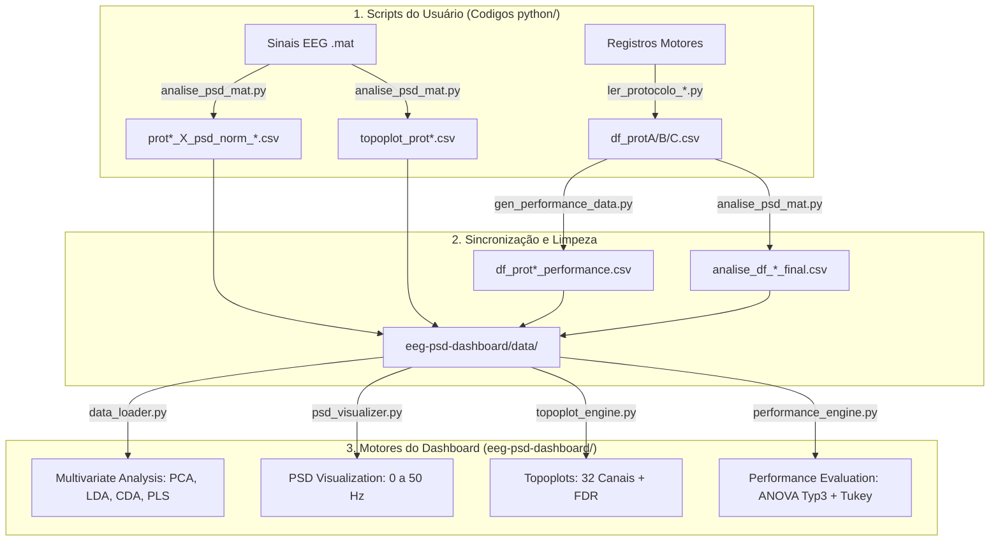

# Manual de Diretrizes e Arquitetura do Agente (Agents.md)

> **AVISO PARA NOVOS AGENTES DE IA:**  
> Leia este documento integralmente antes de planejar ou executar qualquer modificação neste repositório. Ele contém o mapeamento arquitetural do projeto, a divisão estrita de responsabilidades dos códigos, convenções técnicas e regras de segurança (guardrails) invioláveis.

---

## 1. Visão Geral do Projeto e Contexto Científico

Este repositório armazena e processa os dados da pesquisa de Pós-Doutorado da **Profª. Dra. Karina Rodrigues**, intitulada:
> *"Integração sensório-motora e correlatos neurais associados a estímulos vibro-táteis utilizados para representação de movimento e reconhecimento de formas"*.

### O Experimento
O estudo investiga como humanos percebem e processam estímulos táteis dinâmicos aplicados nas pontas dos dedos para o reconhecimento de trajetórias geométricas bidimensionais (formas com 4, 6 ou 8 curvas/segmentos) e como executam motora e cognitivamente a reprodução dessas trajetórias.

O projeto possui **3 Protocolos Experimentais**:
1. **Protocolo A (Estimulação Vibrotátil com Overlap):**
   * Grupos: **CV** (Controle Vibrotátil) vs **SV** (Sensório Vibrotátil / Experimental).
   * Fatores: `Complexidade` (4, 6 e 8 curvas) e `Overlap` (sobreposição temporal de ativação dos atuadores: 0.0, 0.25, 0.5 e 1.0).
2. **Protocolo B (Estimulação de Força sem Overlap):**
   * Grupos: **CF** (Controle Força) vs **SF** (Sensório Força).
   * Fatores: `Complexidade` (4, 6 e 8) e `Grupo`.
3. **Protocolo C (Grupo Único e Baseline):**
   * Grupo: Único (**ALL**).
   * Fatores: `Complexidade` e `Fase` (`Fase Exploracao` e `Fase Execucao`), comparado também contra a **Baseline de Olhos Abertos (OA)**.

### A Suíte `eeg-psd-dashboard`
O `eeg-psd-dashboard` é uma aplicação analítica e interativa desenvolvida em **Python (Dash/Plotly)**. Seu papel principal é integrar e permitir a exploração científica de duas matrizes multidimensionais:
* **Matriz $X \in \mathbb{R}^{T \times F}$ (EEG):** Sinais eletroencefalográficos de 32 canais (sistema 10-20), processados em Densidade de Potência Espectral (PSD por Welch), normalizados pela baseline (formato completo ou bins de 2 em 2 Hz).
* **Matriz $Y \in \mathbb{R}^{T \times C}$ (Comportamento):** Métricas psicométricas de desempenho (`Desempenho`, `Acuracia`, `Similaridade`, `Especificidade`, `Proporção espacial x/y`).

---

## 2. Topologia do Repositório e Regras de Modificação

### ⚠️ Regra de Ouro: Código Legado do Usuário vs. Dashboard

| Diretório / Arquivo | Natureza | Pode ser modificado pelo Agente? | Descrição e Cuidados |
| :--- | :--- | :---: | :--- |
| `Codigos python/` | **Código Legado do Usuário** | ❌ **NÃO MODIFICAR** (A menos que pedido explicitamente) | Scripts criados pelo pesquisador para leitura de dados brutos, gabaritos, cortes temporais e cálculo inicial de PSD (`analise_psd_mat.py`, `ler_protocolo_C.py`, etc.). São fontes primárias de verdade. |
| `Codigos matlab/` | **Código Legado do Usuário** | ❌ **NÃO MODIFICAR** | Rotinas originais em MATLAB (`.m`). Servem de referência matemática (ex: `manova1`). |
| `Dados/` | **Dados Brutos / Processados** | ❌ **NÃO MODIFICAR** | Matrizes brutas de EEG e trajetórias. |
| `TCC/` | **Documentação Acadêmica** | ❌ **NÃO MODIFICAR** | Modelos LaTeX (abnTeX2) do trabalho acadêmico. |
| `eeg-psd-dashboard/` | **Aplicação Interativa** | ✅ **MODIFICÁVEL** | Código da interface web, callbacks e motores estatísticos. Toda nova feature ou correção de UI/UX deve residir aqui. |
| `gen_performance_data.py` | **Script Utilitário na Raiz** | ✅ **MODIFICÁVEL** | Converte e padroniza os CSVs de performance de `Codigos python/` para `eeg-psd-dashboard/data/`. |
| `Agent Conversations/` | **Memória do Agente** | ✅ **MODIFICÁVEL** | Mantém as diretrizes (`Agents.md`) e o histórico de sessões (`conversations.md`). |

---

## 3. Pipeline e Arquitetura de Dados



### Amostras ($N$) de Referência Rápida:
* **Protocolo A:** 16 voluntários na Performance ($N = 1296$ trials: 648 CV / 648 SV). No EEG, 13 voluntários válidos ($N = 1053$ trials: 486 CV / 567 SV; 3 excluídos: `ID_36` CV, `ID_39` CV e `ID_06` SV por inconsistências de corte).
* **Protocolo B:** 18 voluntários na Performance ($N = 486$ trials: 243 CF / 243 SF). No EEG, 10 voluntários válidos ($N = 270$ trials: 135 CF / 135 SF; 8 excluídos: 4 CF e 4 SF).
* **Protocolo C:** 9 voluntários ($N = 324$ trials: 162 Exploração / 162 Execução; no EEG: 144 Execução / 108 Exploração). Na aba de Performance, **sempre usar filtro de Fase Execução ($N = 162$)**. Zero exclusões no EEG.

---

## 4. Motores Estatísticos e Abas do Dashboard

### 1. Multivariate Analysis (`analysis_engine.py` & `anova_engine.py`)
* Projeta os dados em 2D/3D usando PCA, LDA, PLS ou **CDA (MATLAB-Like `manova1`)**.
* Na CDA, reduz o PSD para bins de 2 em 2 Hz (`psd_2em2_norm`) para evitar multicolinearidade e sobreajuste.
* Abaixo da projeção, roda ANOVA One-Way e **Post-Hoc Tukey HSD** (`pairwise_tukeyhsd`) nas coordenadas canônicas ($\text{CD}_1$, $\text{CD}_2$, $\text{CD}_3$) para validar separabilidade estatística dos grupos.

### 2. PSD Visualization (`psd_visualizer.py`)
* Gráficos espectrais interativos de 0 a 50 Hz com bandas clássicas destacadas ($\delta, \theta, \alpha, \beta, \gamma$).
* Suporta estratificação por grupo e sobreposição de curvas (*overlays*).

### 3. Topoplots (`topoplot_engine.py`)
* Renderização 2D do escalpo com 32 eletrodos (montagem padrão 10-20 via `mne`).
* **Comparações Estatísticas:**
  * 2 Painéis: **Teste $t$ de Welch** por canal (`equal_var=False`).
  * 3 Painéis: **ANOVA One-Way F-test** por canal (`calculate_anova_p_from_stats`).
  * **Correção de Múltiplas Comparações:** **FDR (Benjamini-Hochberg, `fdr_bh`)** aplicado nos 32 canais por banda. Canais sobreviventes são destacados com **"x"** no mapa.

### 4. Performance Evaluation (`performance_engine.py`)
* **Modelo Global:** ANOVA Fatorial Tipo III (`ols` + `sm.stats.anova_lm(..., typ=3)`) com interação total entre os fatores.
* **Post-Hoc Fatorial:** Algoritmo customizado `tukey_hsd_from_model` utilizando o erro quadrático médio residual ($MSE_{residual}$) e os graus de liberdade ($df_{residual}$) da própria tabela Tipo III.
* **Visualização:** Gráfico híbrido (dispersão real com jitter + médias com IC95% + colchetes multinível de Tukey com coloração verde intra-grupo e vermelha inter-grupo) e Heatmap de significância matricial.
* **Proporções Espaciais:** Teste $t$ de Welch entre grupos para `Proporção espacial x` e `y`.

---

## 5. Comandos Operacionais

### Executar o Dashboard Localmente
```bash
# A partir da raiz do repositório:
python eeg-psd-dashboard/app.py
```
*Acesse via navegador em:* `http://localhost:8050` ou `http://127.0.0.1:8050`

### Sincronizar Dados de Performance
Caso os CSVs brutos em `Codigos python/` sejam atualizados pelo usuário:
```bash
# Executar a partir da raiz:
python gen_performance_data.py
```

---

## 6. Convenções de Código e Boas Práticas

1. **Codificação de Arquivos (Encoding):**
   * Sempre ler arquivos com fallback robusto de encoding: tentar `utf-8`, seguido de `latin1` ou `cp1252` quando necessário.
   * Salvar novos CSVs sempre com `encoding='utf-8-sig'` ou `utf-8`.
2. **Callbacks do Dash:**
   * Sempre utilizar `prevent_initial_call=True` em callbacks reativos pesados.
   * Ao manipular valores numéricos oriundos de inputs do usuário (como Alpha ou limites de eixo), trate tanto vírgula quanto ponto (`str(val).replace(',', '.')`).
3. **Tratamento do Protocolo C:**
   * O Protocolo C não possui a variável `grupo` dividida (é `ALL`) e não tem `Overlap`. O dashboard oculta automaticamente os seletores de fase e interação quando o Protocolo C está ativo.

---

## 7. Guardrails e Regras Invioláveis do Agente

1. **NUNCA altere os scripts legados em `Codigos python/`** sem autorização explícita e justificada do usuário.
2. **NUNCA modifique ou reescreva gabaritos de trajetórias** por presunção. Qualquer ajuste em gabarito deve ser validado contra matrizes do pesquisador.
3. **NÃO troque a lógica do Post-Hoc Fatorial da Performance:** O Tukey HSD na aba de Performance **deve** continuar consumindo o $MSE$ da tabela da ANOVA Tipo III. Nunca o substitua por um teste one-way descontextualizado.
4. **Respeite o Histórico de Conversas:** Ao iniciar uma nova sessão, consulte sempre o arquivo [`Agent Conversations/conversations.md`](file:///c:/Users/diego/OneDrive/Documents/GitHub/Projeto-Estimulos-Vibrot-teis/Agent%20Conversations/conversations.md) para absorver imediatamente as últimas decisões tomadas.
